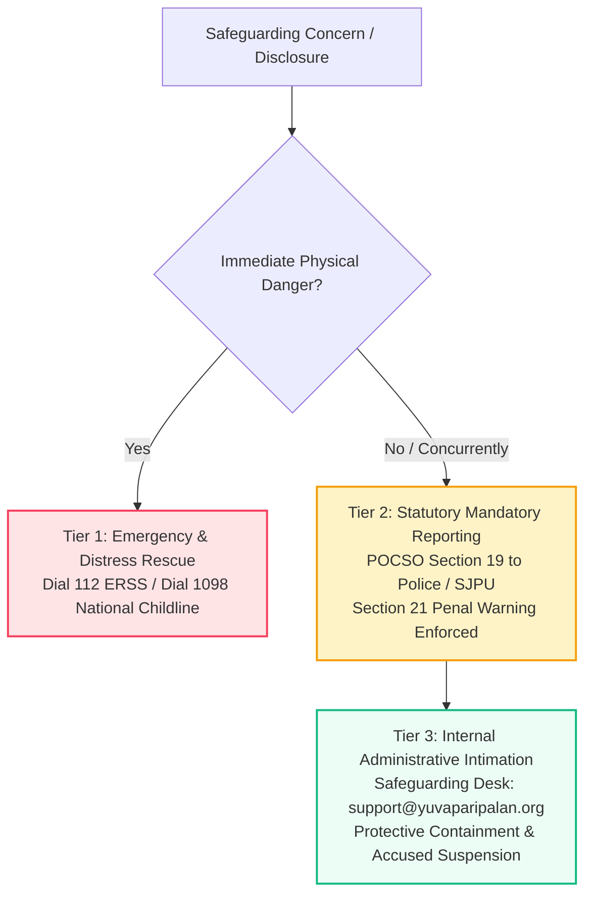

# Yuvaparipalan Foundation — Child Protection & Safeguarding Implementation Review
**Document Reference:** `YPF-DOC-SAFEGUARDING-001`  
**Execution Context:** `YPF-LEGAL-CENTRE-GOVERNANCE-READINESS-002`  
**Authoritative Date:** 25 October 2026  
**Status:** PROVISIONAL DRAFT AUDITED — PENDING FORMAL BOARD DSO APPOINTMENT RESOLUTION  

---

## 1. Executive Summary & Statutory Baseline
The **Yuvaparipalan Foundation** operates digital educational platforms, mentorship circles, youth empowerment events, and community development initiatives. Because youth and minors may access Foundation services or participate in institutional programs with guardian consent, an institutional Child Protection and Safeguarding Policy has been formalized in **Provisional Draft** status at:
- **Canonical Route:** `/child-safeguarding`
- **Component File:** [`src/pages/ChildSafeguardingPage.tsx`](file:///c:/workspace/apps/Foundation%20App/src/pages/ChildSafeguardingPage.tsx)
- **Data Source:** [`src/data/childSafeguardingData.ts`](file:///c:/workspace/apps/Foundation%20App/src/data/childSafeguardingData.ts)

The policy is strictly anchored in:
1. **Protection of Children from Sexual Offences (POCSO) Act, 2012** (specifically Section 19 mandatory reporting, Section 21 statutory failure-to-report penalties, and Section 23 identity non-disclosure).
2. **Juvenile Justice (Care and Protection of Children) Act, 2015**.
3. **Information Technology Act, 2000** and the **IT (Intermediary Guidelines and Digital Media Ethics Code) Rules, 2021**.

---

## 2. Three-Tier Escalation Hierarchy

The updated policy codifies a clear, non-negotiable 3-tier escalation structure:

| Tier Level | Authority & Scope | Operational Channels | Statutory Rule |
| :--- | :--- | :--- | :--- |
| **Tier 1: Immediate Emergency Distress** | Life safety, physical assault, urgent rescue, medical trauma. | **Dial 112** (All-India Emergency Response Support System) **Dial 1098** (National Child Helpline - 24x7 toll-free under MWCD Mission Vatsalya). | Life protection & immediate state rescue. |
| **Tier 2: Statutory Mandatory Reporting** | Apprehension or knowledge of any child sexual offence. | Special Juvenile Police Unit (SJPU) or local police station. | **POCSO Section 19:** Mandatory legal duty for any person to report. **POCSO Section 21:** Imprisonment up to 6 months/fine for failure to report. Internal reporting does NOT substitute for statutory reporting. |
| **Tier 3: Internal Institutional Intimation** | Administrative containment, accused volunteer/mentor suspension, session recording isolation. | Safeguarding Oversight Desk (`safeguarding@yuvaparipalan.org` / `support@yuvaparipalan.org`). | Internal administrative action only; Foundation has no police or adjudicatory powers. |

---

## 3. Institutional Governance & Non-Fabrication Certification
In accordance with mandatory conditions:
- **Provisional Banner Displayed:** Rendered prominently at the top of [`ChildSafeguardingPage.tsx`](file:///c:/workspace/apps/Foundation%20App/src/pages/ChildSafeguardingPage.tsx).
- **No Fictitious Officers:** The policy **does not invent or name fictitious Designated Safeguarding Officers (DSO)**.
- **Mandatory Action Item for Governing Board:**
  - The Governing Board must formally pass a resolution designating:
    1. A Named Lead Designated Child Safeguarding Officer (Lead DSO).
    2. A Deputy Child Safeguarding Officer.
  - Once appointed, the named individuals and dedicated desk direct contact will be updated in `src/data/childSafeguardingData.ts`.
