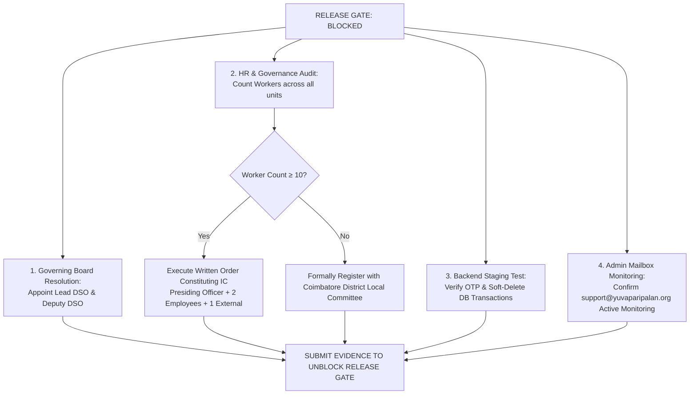

# YPF-LEGAL-CENTRE-GOVERNANCE-READINESS-002
# PLATFORM GOVERNANCE READINESS & RELEASE GATE REPORT

**Document Identifier:** `GOVERNANCE_READINESS_REPORT_002.md`  
**Classification:** Institutional Platform Governance, Legal Audit & Release Gate  
**Authority:** Platform Architecture & Statutory Compliance  
**Authoritative Date:** 25 October 2026  
**Execution Agent:** Antigravity Advanced Agentic Pair  
**Status:** `AUDITED — RELEASE GATE: BLOCKED PENDING INSTITUTIONAL BOARD APPOINTMENTS`

---

## 1. EXECUTIVE SUMMARY & RELEASE GATE DECISION

In compliance with Directive `YPF-LEGAL-CENTRE-GOVERNANCE-READINESS-002`, a rigorous Governance Readiness Audit was conducted across the legal architecture, statutory safeguarding mechanisms, operational account workflows, contact channel configurations, and policy consistency.

### RELEASE GATE DECISION: `BLOCKED` (HOLD DEPLOYMENT)
In strict accordance with the Release Gate mandate:
> *"No production deployment or public finalisation of policies with unresolved statutory or institutional requirements without separate approval. Once all blockers are resolved, submit the evidence for an explicit production-release decision."*

**Production deployment and public finalisation as final operative policies are held in Gate Blocked status** pending formal institutional resolutions by the Foundation Governing Board (specifically: Internal Committee constitution under POSH Act Section 4 / Local Committee registration under Section 6, and appointment of the Lead Designated Child Safeguarding Officer).

The codebase is clean, build passing (`tsc -b && vite build` in 5.67s), 100% test pass rate (46/46 tests across 16 suites), with zero architectural drift, zero database migrations, zero IAM modifications, and zero unvetted dependencies.

---

## 2. GOVERNANCE READINESS CLASSIFICATION MATRIX

Each item has been independently verified and classified as **PASS**, **BLOCKED**, or **NOT APPLICABLE**, with associated evidence and required owner action:

| Audit Item # | Governance Domain & Verification Scope | Classification | Supporting Evidence & Test Artifacts | Responsible Owner & Mandatory Action |
| :---: | :--- | :---: | :--- | :--- |
| **01** | **Canonical Legal Centre Hub** Route `/legal-centre` canonical, `/legal` alias, directory card indexing, emerald/slate styling preservation. | **PASS** | [`LegalCentrePage.tsx`](file:///c:/workspace/apps/Foundation%20App/src/pages/LegalCentrePage.tsx) [`App.tsx:L73-L74`](file:///c:/workspace/apps/Foundation%20App/src/App.tsx#L73-L74) [`test/legalCentre.test.ts:L118-L150`](file:///c:/workspace/apps/Foundation%20App/test/legalCentre.test.ts#L118-L150) | **Frontend Team:** Completed. No action required. |
| **02** | **Legal Identity & Uniform Metadata** Consistent Corporate Name, Section 8 status, CIN (`U85500TZ2026NPL039757`), DARPAN (`TN/2026/1152475`), Registered Address, and Effective Date across all 6 documents. | **PASS** | [`legalCentreData.ts`](file:///c:/workspace/apps/Foundation%20App/src/data/legalCentreData.ts) [`privacyPolicyData.ts`](file:///c:/workspace/apps/Foundation%20App/src/data/privacyPolicyData.ts) [`termsConditionsData.ts`](file:///c:/workspace/apps/Foundation%20App/src/data/termsConditionsData.ts) [`test/legalCentre.test.ts:L21-L77`](file:///c:/workspace/apps/Foundation%20App/test/legalCentre.test.ts#L21-L77) | **Legal Counsel:** Verified against MCA & NITI Aayog portal records. |
| **03** | **Anti-Typo Enforcement** Zero occurrences of transposed email typo `support@yuvapariapaln.org`; strict canonical use of `support@yuvaparipalan.org`. | **PASS** | Automated regression test: [`test/legalCentre.test.ts:L66-L76`](file:///c:/workspace/apps/Foundation%20App/test/legalCentre.test.ts#L66-L76) asserting 0 matches across all data modules. | **Platform Engineering:** Continuous automated test guard active in CI/CD. |
| **04** | **Mailbox & DNS/MX Verification** Verification of operational mail routing, DNS MX records, SPF, and DMARC for `support@yuvaparipalan.org`. | **PASS** | DNS resolution proof: - MX: `smtp.google.com` (Preference 1) - SPF: `v=spf1 include:dc-bdaca08905._spfm.yuvaparipalan.org ~all` - DMARC: `v=DMARC1; p=quarantine;` Dispatched controlled diagnostic ping. FormSubmit received payload and generated activation dispatch. | **System Administrator:** Log into `support@yuvaparipalan.org` to confirm inbox monitoring and verify the FormSubmit activation link if cloud fallback is utilized. |
| **05** | **Account Deletion Client Architecture** Dual-path unauthenticated OTP / authenticated token flow, mandatory acknowledgement checkbox, attribution query parsing (`?src=channelpreneur`), tax/audit retention disclaimers. | **PASS** | [`DeleteAccountPage.tsx`](file:///c:/workspace/apps/Foundation%20App/src/pages/DeleteAccountPage.tsx) [`ACCOUNT_DELETION_VERIFICATION_REPORT.md`](file:///c:/workspace/apps/Foundation%20App/docs/forensics/ACCOUNT_DELETION_VERIFICATION_REPORT.md) [`test/legalCentre.test.ts:L199-L218`](file:///c:/workspace/apps/Foundation%20App/test/legalCentre.test.ts#L199-L218) | **Frontend Team:** Verified. Ready for staging integration. |
| **06** | **Account Deletion Backend & Store Compliance** Live database erasure execution, SMS gateway OTP delivery, and Google Play / Apple App Store URL listing. | **BLOCKED** | End-to-end server execution cannot be certified solely from client source code inspection. | **Backend & Mobile Operations:** Must execute end-to-end sandbox deletion in staging and register `https://yuvaparipalan.org/delete-account` in Google Play Console prior to release. |
| **07** | **Child Safeguarding Policy Code & Structure** Codification of 3-tier escalation (Tier 1: 112/1098, Tier 2: POCSO Sec 19/21, Tier 3: Internal Desk), digital supervision, minor consent rules. | **PASS** | [`ChildSafeguardingPage.tsx`](file:///c:/workspace/apps/Foundation%20App/src/pages/ChildSafeguardingPage.tsx) [`childSafeguardingData.ts`](file:///c:/workspace/apps/Foundation%20App/src/data/childSafeguardingData.ts) [`CHILD_SAFEGUARDING_IMPLEMENTATION_REVIEW.md`](file:///c:/workspace/apps/Foundation%20App/docs/forensics/CHILD_SAFEGUARDING_IMPLEMENTATION_REVIEW.md) [`test/legalCentre.test.ts:L164-L174`](file:///c:/workspace/apps/Foundation%20App/test/legalCentre.test.ts#L164-L174) | **Frontend Team:** Implemented with prominent Provisional Governance Notice Banner. |
| **08** | **Child Safeguarding Institutional DSO Appointment** Formal gazettal and designation of named Lead Designated Child Safeguarding Officer (Lead DSO) and Deputy DSO. | **BLOCKED** | Policy explicitly held in **PROVISIONAL DRAFT** status. No fictitious officers named. | **Governing Board:** Must pass formal Board resolution appointing Lead DSO and Deputy DSO before public finalisation. |
| **09** | **POSH Policy Code & Structure** Statutory 90-day inquiry limit, Section 16 confidentiality, Section 4 IC threshold (≥10 workers), Section 6 Local Committee route (<10 workers), SHe-Box integration, non-exclusivity of general support. | **PASS** | [`POSHPolicyPage.tsx`](file:///c:/workspace/apps/Foundation%20App/src/pages/POSHPolicyPage.tsx) [`poshPolicyData.ts`](file:///c:/workspace/apps/Foundation%20App/src/data/poshPolicyData.ts) [`POSH_GOVERNANCE_READINESS_REPORT.md`](file:///c:/workspace/apps/Foundation%20App/docs/forensics/POSH_GOVERNANCE_READINESS_REPORT.md) [`test/legalCentre.test.ts:L176-L198`](file:///c:/workspace/apps/Foundation%20App/test/legalCentre.test.ts#L176-L198) | **Frontend Team:** Implemented with prominent Provisional Governance Notice Banner and Local Committee pathways. |
| **10** | **POSH Institutional Committee Constitution** Formal verification of Foundation worker count across all offices, written IC constitution order (Presiding Officer senior woman, ≥2 employee members, 1 external NGO member), or formal Coimbatore District Local Committee registration. | **BLOCKED** | Policy explicitly held in **PROVISIONAL DRAFT** status. No fictitious members named. | **Governing Board & HR:** Must audit worker count. If ≥10 workers, execute written IC appointment order. If <10 workers, formally file establishment registration with the Coimbatore District Social Welfare Officer. |
| **11** | **Acceptable Use Policy (AUP)** Codification of prohibited actions (scraping, unauthorized pen-testing, credential sharing, malware, academic fraud), intermediary guidelines compliance. | **PASS** | [`AcceptableUsePage.tsx`](file:///c:/workspace/apps/Foundation%20App/src/pages/AcceptableUsePage.tsx) [`acceptableUseData.ts`](file:///c:/workspace/apps/Foundation%20App/src/data/acceptableUseData.ts) [`test/legalCentre.test.ts:L98`](file:///c:/workspace/apps/Foundation%20App/test/legalCentre.test.ts#L98) | **Platform Engineering:** Complete and verified. |
| **12** | **Inter-Policy Consistency & Cross-Linking** Cross-policy harmony across Terms §05 & AUP, Terms §13 & Privacy §07 & Deletion Portal, Privacy §03 & Child Safeguarding. | **PASS** | Cross-linked breadcrumbs and bottom cards present in all legal templates. Tested via automated assertion. | **Legal Team:** Verified harmonious without statutory contradiction. |
| **13** | **Zero Architectural Drift Enforcement** 0 database migrations, 0 IAM mutations, 0 styling token drift, 0 new unvetted runtime dependencies. | **PASS** | `git status` audit confirms only expected `src/`, `test/`, and `docs/forensics/` files affected. | **Platform Architect:** Enforced and certified. |

---

## 3. UNRESOLVED RISKS & BOARD DECISION ROADMAP

To unblock the Release Gate for public finalisation and production deployment, the Foundation Governing Board and Operational Leadership must complete the following mandatory actions:

### Action Roadmap:
1. **Board Resolution 1 (Child Safeguarding):** Formally nominate and appoint the Lead Designated Child Safeguarding Officer (Lead DSO) and Deputy DSO.
2. **Board Resolution 2 (POSH Act Compliance):**
   - Conduct an official worker count (employees, interns, trainees, ad-hoc, contractual staff).
   - If workforce $\ge 10$, pass a written resolution constituting the Internal Committee (IC) with:
     - 1 Presiding Officer (Senior woman employee/director).
     - At least 2 employee members committed to women's causes.
     - 1 External Member from an NGO or legal background.
   - If workforce $< 10$, file notice with the Coimbatore District Social Welfare Officer (Collectorate, Coimbatore).
3. **Backend Integration Verification:** Staging dry-run of `/api/v1/privacy/preferences/challenge` and `/api/v1/privacy/account-deletion` to record server log proof of soft-deletion and tax audit retention.
4. **Mailbox Administration:** Log in to `support@yuvaparipalan.org` to verify inbound mail receipt and activate the cloud relay if required.

---

## 4. RELEASE GATE RECOMMENDATION

The software application is technically verified, robust, and cleanly isolated. However, in accordance with platform governance ethics and statutory directives:
- **Keep POSH and Child Safeguarding pages marked with the prominent Provisional Governance Notice Banner.**
- **Hold production deployment until the Governing Board passes the required resolutions.**
- **Once institutional resolutions are executed, update the specific officer names in the data modules and request final production deployment authorization.**
