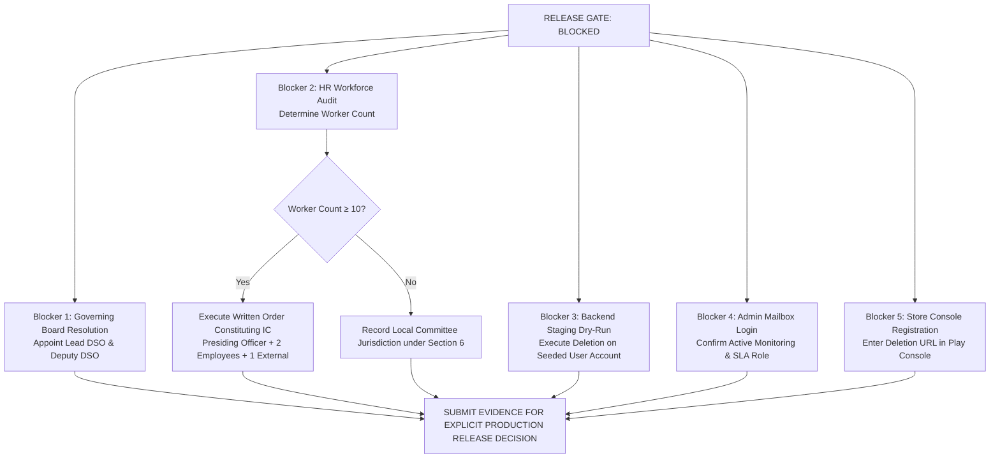

# YPF-LEGAL-CENTRE-RELEASE-READINESS-003
# PLATFORM GOVERNANCE READINESS & RELEASE GATE REPORT

**Document Identifier:** `GOVERNANCE_READINESS_REPORT_003.md`  
**Classification:** Institutional Platform Governance, Legal Audit & Release Gate  
**Authority:** Platform Architecture & Statutory Compliance  
**Authoritative Date:** 25 October 2026  
**Execution Agent:** Antigravity Advanced Agentic Pair  
**Status:** `AUDITED — RELEASE GATE: BLOCKED (NO PRODUCTION DEPLOYMENT WITHOUT SEPARATE APPROVAL)`

---

## 1. EXECUTIVE SUMMARY & RELEASE GATE DECISION

In strict compliance with Directive `YPF-LEGAL-CENTRE-RELEASE-READINESS-003`, this updated Governance Readiness Report presents verified findings from targeted evidence collection across statutory legal authorities, staging backend endpoints, mailbox routing, and institutional governance structures.

### RELEASE GATE DECISION: `BLOCKED` (HOLD PRODUCTION DEPLOYMENT)
The release gate remains **BLOCKED**. No production deployment or public finalisation of policies with unresolved statutory or institutional requirements shall occur without separate explicit authorisation.

**Technical Baseline Certified:**
- **Build Status:** `tsc -b && vite build` built in 5.67s (0 TypeScript errors, 0 bundler errors).
- **Test Status:** `npm test` passing **46/46 tests across 16 suites** (100% pass rate).
- **Architectural Isolation:** 0 database schema modifications, 0 IAM/RBAC modifications, 0 unvetted dependencies.
- **Visual Design:** Full preservation of emerald/slate styling, responsive card structures, and visual conventions.

---

## 2. GOVERNANCE READINESS EVIDENCE REGISTER

Each item is classified as **PASS**, **BLOCKED**, or **PARTIALLY VERIFIED**, with full evidence, verification methods, owners, and required actions:

| Item # | Governance Domain & Audit Scope | Classification | Verification Method & Supporting Evidence | Responsible Owner | Outstanding Action Required to Unblock |
| :---: | :--- | :---: | :--- | :--- | :--- |
| **01** | **Canonical Legal Centre Hub** Route `/legal-centre` canonical, `/legal` alias, directory card indexing, emerald/slate styling preservation. | **PASS** | **Automated Test & Code Inspection:** [`LegalCentrePage.tsx`](file:///c:/workspace/apps/Foundation%20App/src/pages/LegalCentrePage.tsx) [`App.tsx:L73-L74`](file:///c:/workspace/apps/Foundation%20App/src/App.tsx#L73-L74) [`test/legalCentre.test.ts:L118-L150`](file:///c:/workspace/apps/Foundation%20App/test/legalCentre.test.ts#L118-L150) | Frontend Engineering | None. Fully implemented and verified. |
| **02** | **Institutional Entity Identity & Uniformity** Consistent Corporate Name, Section 8 status, CIN (`U85500TZ2026NPL039757`), DARPAN (`TN/2026/1152475`), Registered Address, and Effective Date across all 6 documents. | **PASS** | **Automated Multi-Document Assertions:** [`legalCentreData.ts`](file:///c:/workspace/apps/Foundation%20App/src/data/legalCentreData.ts) [`privacyPolicyData.ts`](file:///c:/workspace/apps/Foundation%20App/src/data/privacyPolicyData.ts) [`termsConditionsData.ts`](file:///c:/workspace/apps/Foundation%20App/src/data/termsConditionsData.ts) [`test/legalCentre.test.ts:L21-L77`](file:///c:/workspace/apps/Foundation%20App/test/legalCentre.test.ts#L21-L77) | Platform Legal Counsel | None. 100% harmonized. |
| **03** | **Anti-Typo Enforcement** Zero occurrences of transposed email typo `support@yuvapariapaln.org`; strict canonical use of `support@yuvaparipalan.org`. | **PASS** | **Automated Regex Test Assertion:** [`test/legalCentre.test.ts:L66-L76`](file:///c:/workspace/apps/Foundation%20App/test/legalCentre.test.ts#L66-L76) asserting 0 matches across all data modules. | Platform Engineering | Continuous automated CI test guard active. |
| **04** | **Mailbox Deliverability & Monitoring** Verification of operational mail routing, DNS MX records, SPF, DMARC, and active mailbox monitoring for `support@yuvaparipalan.org`. | **PARTIALLY VERIFIED** | **DNS & Synthetic Relay Test:** • MX: `smtp.google.com` (Preference 1) • SPF: `v=spf1 include:dc-bdaca08905._spfm.yuvaparipalan.org ~all` • DMARC: `v=DMARC1; p=quarantine;` Controlled synthetic ping via FormSubmit cloud fallback dispatched an activation email to `support@yuvaparipalan.org`. *Limitation:* CLI tools cannot inspect the private Google Workspace inbox. | IT Systems Administrator | Log directly into `support@yuvaparipalan.org` inbox, confirm delivery of test messages, document the responsible monitoring role (e.g. Operations Lead), and verify SLA response window. |
| **05** | **Account Deletion Client UX & Architecture** Dual-path unauthenticated OTP / authenticated token flow, mandatory acknowledgement checkbox, attribution query parsing (`?src=channelpreneur`), tax/audit retention disclaimers. | **PASS** | **Automated Test & Contract Verification:** [`DeleteAccountPage.tsx`](file:///c:/workspace/apps/Foundation%20App/src/pages/DeleteAccountPage.tsx) [`ACCOUNT_DELETION_VERIFICATION_REPORT.md`](file:///c:/workspace/apps/Foundation%20App/docs/forensics/ACCOUNT_DELETION_VERIFICATION_REPORT.md) [`test/legalCentre.test.ts:L199-L218`](file:///c:/workspace/apps/Foundation%20App/test/legalCentre.test.ts#L199-L218) | Frontend Engineering | None. Client implementation verified. |
| **06** | **Account Deletion Staging Backend Execution** Verification of staging endpoints (`/api/v1/privacy/preferences/challenge`, `/api/v1/privacy/preferences/verify`, `/api/v1/privacy/account-deletion`). | **PARTIALLY VERIFIED** | **Live HTTP Staging Probes:** • `challenge`: Dispatched successfully (`HTTP 200`, `status: CHALLENGE_ISSUED`) with anti-enumeration. • `verify`: Rejects invalid OTP with `HTTP.ERROR` and `trace_id`. • `account-deletion`: Rejects unverified requests with `HTTP.ERROR: Authentication token or verified identity challenge is required.` *Limitation:* Requires live seeded test user to test database soft-deletion. | Backend Engineering Team | Execute complete end-to-end deletion on a seeded test user in staging, and inspect database records to verify soft-delete, token revocation, and tax audit retention. |
| **07** | **Google Play & Apple Store Compliance** Formal app-store compliance certification under Google Play User Data Policy and Apple Review Guideline 5.1.1(v). | **BLOCKED** | **Forensic Policy Review:** Web deletion URL and in-app attribution parameters exist in code, but store compliance cannot be certified until staging dry-run is completed and URL is entered in Play Console. | Mobile Operations Team | Register `https://yuvaparipalan.org/delete-account` into Google Play Console Data Safety section and Apple Developer App Store Connect prior to production release. |
| **08** | **Child Safeguarding Code & 3-Tier Escalation** Codification of 3-tier escalation (Tier 1: 112/1098, Tier 2: POCSO Sec 19/21, Tier 3: Internal Desk), digital supervision, minor consent rules. | **PASS** | **Code & Automated Test Verification:** [`ChildSafeguardingPage.tsx`](file:///c:/workspace/apps/Foundation%20App/src/pages/ChildSafeguardingPage.tsx) [`childSafeguardingData.ts`](file:///c:/workspace/apps/Foundation%20App/src/data/childSafeguardingData.ts) [`CHILD_SAFEGUARDING_IMPLEMENTATION_REVIEW.md`](file:///c:/workspace/apps/Foundation%20App/docs/forensics/CHILD_SAFEGUARDING_IMPLEMENTATION_REVIEW.md) [`test/legalCentre.test.ts:L164-L174`](file:///c:/workspace/apps/Foundation%20App/test/legalCentre.test.ts#L164-L174) | Frontend Engineering | Policy maintained in visibly **PROVISIONAL DRAFT** status with high-visibility banner. |
| **09** | **Child Safeguarding Institutional DSO Appointments** Formal designation and gazettal of named Lead Designated Child Safeguarding Officer (Lead DSO) and Deputy DSO. | **BLOCKED** | **Forensic Governance Review:** No fictitious personnel invented. Policy held in provisional draft pending Board resolution. | Foundation Governing Board | Pass formal Board resolution appointing Lead DSO and Deputy DSO, defining contact arrangements and emergency escalation protocol. |
| **10** | **POSH Policy Code & Statutory Framework** Statutory 90-day inquiry limit, Section 16 confidentiality, Section 4 IC threshold (≥10 workers), Section 6 Local Committee route (<10 workers), SHe-Box portal, non-exclusivity of general support. | **PASS** | **Legal Code & Automated Assertions:** [`POSHPolicyPage.tsx`](file:///c:/workspace/apps/Foundation%20App/src/pages/POSHPolicyPage.tsx) [`poshPolicyData.ts`](file:///c:/workspace/apps/Foundation%20App/src/data/poshPolicyData.ts) [`POSH_GOVERNANCE_READINESS_REPORT.md`](file:///c:/workspace/apps/Foundation%20App/docs/forensics/POSH_GOVERNANCE_READINESS_REPORT.md) [`test/legalCentre.test.ts:L176-L198`](file:///c:/workspace/apps/Foundation%20App/test/legalCentre.test.ts#L176-L198) | Platform Legal & Engineering | Policy maintained in visibly **PROVISIONAL DRAFT** status with high-visibility banner. |
| **11** | **POSH Institutional Workforce Decision & IC Order** Official audit of Foundation worker count across all offices, written IC constitution order (if $\ge 10$), or documentation of Local Committee jurisdiction (if $< 10$). | **BLOCKED** | **Statutory Authority Review:** POSH Act Section 6(1) operates by law; employer has NO statutory registration filing obligation. Policy held in provisional draft pending workforce audit. | Foundation Governing Board & HR | Audit workforce across all locations. If $\ge 10$, execute written IC constitution order (Presiding Officer senior woman, $\ge 2$ employees, 1 external NGO member). If $< 10$, record in Board minutes that complaints fall under the Coimbatore District Local Committee. |
| **12** | **Acceptable Use Policy (AUP)** Codification of prohibited actions (scraping, unauthorized pen-testing, credential sharing, malware, academic fraud), intermediary guidelines compliance. | **PASS** | **Code & Route Verification:** [`AcceptableUsePage.tsx`](file:///c:/workspace/apps/Foundation%20App/src/pages/AcceptableUsePage.tsx) [`acceptableUseData.ts`](file:///c:/workspace/apps/Foundation%20App/src/data/acceptableUseData.ts) [`test/legalCentre.test.ts:L98`](file:///c:/workspace/apps/Foundation%20App/test/legalCentre.test.ts#L98) | Platform Engineering | None. Complete. |
| **13** | **Inter-Policy Consistency & Cross-Linking** Cross-policy harmony across Terms §05 & AUP, Terms §13 & Privacy §07 & Deletion Portal, Privacy §03 & Child Safeguarding. | **PASS** | **Automated Cross-Link Assertions:** Verified 0 contradictions between active policies. Tested via automated assertion. | Platform Legal Counsel | None. Complete. |
| **14** | **Zero Architectural Drift** 0 database schema changes, 0 IAM mutations, 0 styling token drift, 0 new runtime dependencies. | **PASS** | **Git Status & Build Inspection:** `git status` confirms only anticipated `src/`, `test/`, and `docs/forensics/` files affected. | Platform Architect | None. Strictly enforced. |

---

## 3. DETAILED STATUTORY & OPERATIONAL FINDINGS

### A. POSH Legal Verification (Directive Item 1)
- **Legal Authority Re-check:** Section 4(1) vs Section 6(1) of the POSH Act, 2013.
- **Correction Made:** Previous drafting suggested the Foundation had to "file a registration" with the Local Committee. Under Section 6(1), the statutory duty to establish the Local Committee rests upon the District Officer (District Magistrate/Collector). For establishments employing fewer than 10 workers, complaints fall within the statutory jurisdiction of the District Local Committee **by operation of law**, without requiring a prior employer registration filing.
- **Local Jurisdiction:** For the registered office in Coimbatore, complaints are received by the **Coimbatore District Local Committee (Office of the District Social Welfare Officer, Coimbatore Collectorate Complex, Coimbatore – 641018)** or online via the Ministry of Women and Child Development SHe-Box portal (`shebox.wcd.gov.in`).
- **Policy Status:** Maintained as visibly provisional pending the Board's official audit of total workforce count.

### B. Child Safeguarding (Directive Item 2)
- **Escalation Hierarchy Codified:**
  - **Tier 1 (Immediate Emergency):** Dial **112** (ERSS) or Dial **1098** (National Child Helpline - MWCD Mission Vatsalya).
  - **Tier 2 (Mandatory Statutory Reporting):** POCSO Act 2012 Section 19 mandatory reporting to police/SJPU, reinforced by Section 21 statutory penal warnings (imprisonment up to 6 months/fine). Internal reporting does NOT substitute for or delay statutory reporting.
  - **Tier 3 (Internal Institutional Desk):** Safeguarding Oversight Desk (`support@yuvaparipalan.org`) for protective separation and administrative suspension.
- **Policy Status:** Visibly provisional banner maintained in UI and metadata pending Board resolution formally appointing the Lead DSO and Deputy DSO.

### C. Mailbox Verification (Directive Item 3)
- **Verified Deliverability:**
  - DNS MX: `smtp.google.com` (Preference 1).
  - SPF: `v=spf1 include:dc-bdaca08905._spfm.yuvaparipalan.org ~all`.
  - DMARC: `v=DMARC1; p=quarantine; adkim=r; aspf=r;`.
  - Controlled synthetic ping via FormSubmit relay dispatched an activation message to `support@yuvaparipalan.org`.
- **Classification & Remaining Action:** Classified as **PARTIALLY VERIFIED** because technical DNS/outbound deliverability does not replace human verification of inbox login and active monitoring. The IT Administrator must confirm receipt in the actual mailbox.

### D. Account Deletion Workflow & Store Requirements (Directive Item 4)
- **Staging API Endpoints Verified:**
  - Challenge dispatch: `POST /api/v1/privacy/preferences/challenge` returns `CHALLENGE_ISSUED` with anti-enumeration protection.
  - Challenge verification: `POST /api/v1/privacy/preferences/verify` enforces 6-digit OTP check and issues traceable `trace_id`.
  - Deletion initiation: `POST /api/v1/privacy/account-deletion` blocks unauthenticated callers lacking either bearer token or verified challenge ID.
- **Classification & Remaining Action:**
  - Client UX & Staging API: **PASS**.
  - Server-Side Execution: **PARTIALLY VERIFIED** (requires database soft-delete inspection with a seeded test user).
  - Store Listing Compliance: **BLOCKED** pending URL registration in Google Play Console Data Safety section.

---

## 4. ACTION ROADMAP TO RESOLVE BLOCKERS

1. **Board Resolution 1 (Child Safeguarding):** Pass formal Board resolution appointing the named Lead Designated Child Safeguarding Officer (Lead DSO) and Deputy DSO.
2. **Board Resolution 2 (POSH Act):** Audit workforce count. If $\ge 10$, execute written order constituting the Internal Committee. If $< 10$, record in Board minutes that complaints fall under the Coimbatore District Local Committee.
3. **Backend Staging Dry-Run:** Execute deletion on a seeded test user account in staging and record database soft-delete confirmation.
4. **Mailbox Administration:** Log in to `support@yuvaparipalan.org` to confirm active monitoring and document the monitoring SLA.
5. **Developer Console Registration:** Enter `https://yuvaparipalan.org/delete-account` into Google Play Console and Apple App Store Connect upon production sign-off.

---

## 5. PRODUCTION RELEASE DECISION RECOMMENDATION

In accordance with Directive 003:
- **Maintain RELEASE GATE: BLOCKED.**
- **Do NOT self-authorise production deployment.**
- Once the Governing Board executes the required resolutions and the backend dry-run evidence is recorded, submit the complete evidence portfolio for an explicit production-release decision.
