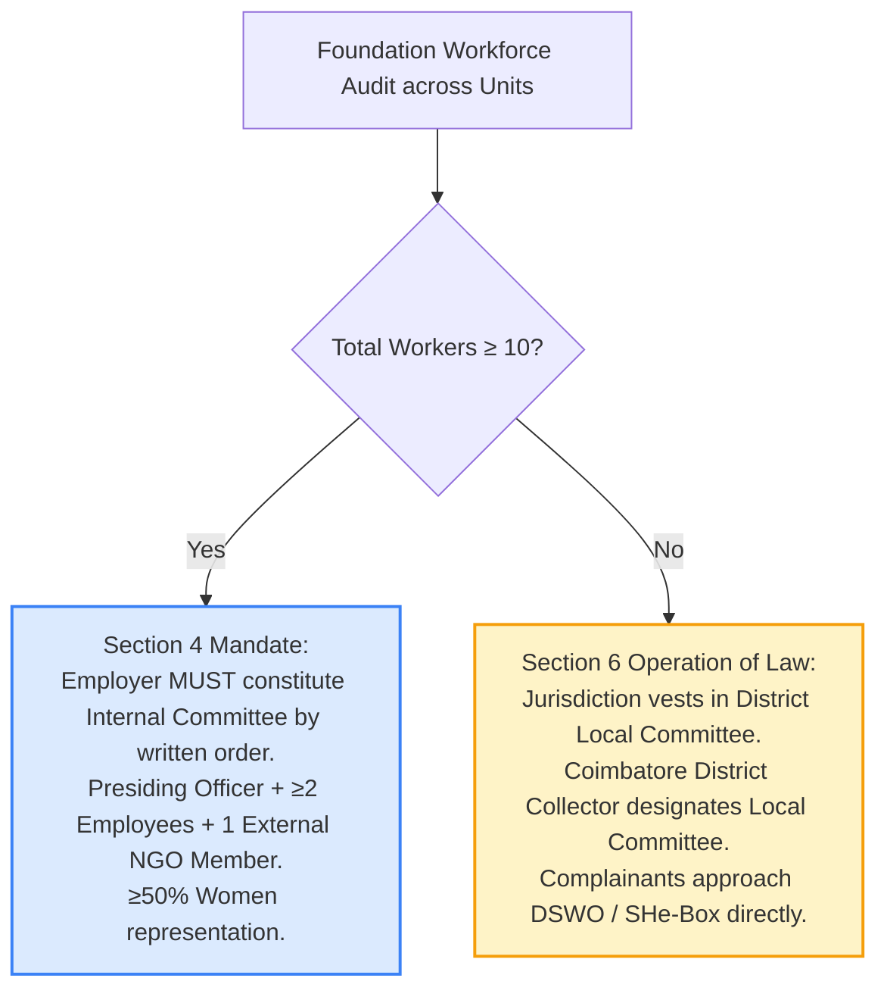

# Yuvaparipalan Foundation — Prevention of Sexual Harassment (POSH) Governance Readiness Report
**Document Reference:** `YPF-DOC-POSH-001`  
**Execution Context:** `YPF-LEGAL-CENTRE-RELEASE-READINESS-003`  
**Authoritative Date:** 25 October 2026  
**Status:** PROVISIONAL DRAFT AUDITED — PENDING INSTITUTIONAL WORKFORCE DETERMINATION & WRITTEN IC ORDER  

---

## 1. Statutory Mandate & Purpose
In compliance with the **Sexual Harassment of Women at Workplace (Prevention, Prohibition and Redressal) Act, 2013** (“POSH Act”) and the **POSH Rules, 2013**, the **Yuvaparipalan Foundation** provides a dignified, safe, and respectful environment for all women employees, fellows, interns, volunteers, consultants, channelpreneurs, and community members.

The policy has been codified and published in **Visibly Provisional Institutional Draft** form at:
- **Canonical Route:** `/posh`
- **Component File:** [`src/pages/POSHPolicyPage.tsx`](file:///c:/workspace/apps/Foundation%20App/src/pages/POSHPolicyPage.tsx)
- **Data Source:** [`src/data/poshPolicyData.ts`](file:///c:/workspace/apps/Foundation%20App/src/data/poshPolicyData.ts)

---

## 2. Rigorous Statutory Verification: Workforce Thresholds & Local Committee Framework

Following Directive 003, a re-check of statutory provisions under the POSH Act and Tamil Nadu state administration rules was conducted:

### Critical Legal Findings:
1. **Absence of Employer Local Committee Registration Obligation:**
   - Under Section 6(1) of the POSH Act, the statutory duty to constitute the Local Committee rests upon the **District Officer** (District Magistrate / Collector), not the employer.
   - For an establishment employing fewer than 10 workers, the POSH Act does **NOT** require the employer to "register" or "notify" its establishment with the Local Committee to activate its jurisdiction.
   - Rather, by operation of law under Section 6(1) and Section 9(1), any aggrieved woman in an establishment with fewer than 10 workers (or where the complaint is against the employer itself) possesses an immediate statutory right to file a complaint directly with the District Local Committee.
2. **Competent District Authority for Registered Office:**
   - The Foundation's registered office is located at `#3, Sri Mahalakshmi Garden, Saravanampatti, Coimbatore, Tamil Nadu – 641035`.
   - In Coimbatore District, the District Collector has designated the **District Social Welfare Officer (DSWO)** at the Coimbatore District Collectorate as the nodal officer / member secretary for the Coimbatore District Local Committee.
   - Complainants may submit complaints in person or by post to:
     *Office of the District Social Welfare Officer, District Collectorate, Coimbatore, Tamil Nadu – 641018*, or online via the Government of India SHe-Box portal (`shebox.wcd.gov.in`).
3. **Non-Exclusivity & Strict Confidentiality:**
   - The policy explicitly prohibits directing statutory sexual harassment complaints exclusively to general customer support (`support@yuvaparipalan.org`).
   - General support is an administrative directory and cannot guarantee Section 16 statutory confidentiality.
   - Authorized channels codified:
     a) Statutory External: Coimbatore District Local Committee / MWCD SHe-Box.
     b) Confidential Physical: Sealed envelope marked "ATTENTION: INTERNAL COMMITTEE / LOCAL COMMITTEE" delivered to the registered office.
     c) Dedicated Intake: `posh-committee@yuvaparipalan.org` (to be activated upon IC gazettal, isolated from support).
     d) General support: limited to procedural guidance only.

---

## 3. Institutional Fact Verification & Non-Fabrication Certification
To maintain forensic integrity and avoid misleading the public:
1. **Visibly Provisional Draft Enforced:** Rendered with a high-visibility amber/purple notice banner in [`POSHPolicyPage.tsx`](file:///c:/workspace/apps/Foundation%20App/src/pages/POSHPolicyPage.tsx) and Section 00 of [`poshPolicyData.ts`](file:///c:/workspace/apps/Foundation%20App/src/data/poshPolicyData.ts).
2. **Zero Fabrication:** The policy text **does not invent or name fictitious individuals** as Presiding Officer or External Members.
3. **Mandatory Action Item for Governing Board & HR:**
   - Officially audit the Foundation's workforce count (including employees, interns, trainees, ad-hoc, contractual staff).
   - If workforce $\ge 10$, pass a written Board resolution constituting the Internal Committee (IC) with:
     - 1 Presiding Officer (Senior woman employee/director).
     - At least 2 employee members committed to women's causes.
     - 1 External Member from an NGO or legal background.
   - If workforce $< 10$, document in Board minutes that complaints are subject to the jurisdiction of the Coimbatore District Local Committee under Section 6(1) of the Act.
